# Directive active du 2 octobre 2026 — Recherche initiale à 100

La clarification utilisateur remplace la trajectoire 2000→500→100 ci-dessous :
la recherche initiale doit émettre directement au plus 100 SIRET et atteindre
99,2 % de recall SIRET humain exact AVANT tout reranker, ranker ou decider
aval. Aucun résultat après LambdaMART ne vaut validation de cette recherche.
Les profondeurs 2000 et 500 ne sont plus des objectifs ni des gates de ce
nouveau volet. Ne pas recréer un pool fixe puis le reclasser sous un autre nom.

Contrat du volet : `docs/retrieval_v38_initial_top100_contract.md`.
Conserver les protections all-human, absence de positif injecté, folds2/3/4
uniquement, fold0 contaminé et fold1 fermé, sources officielles sans alias CRM
ni identifiants comme features, exact/opérationnel séparés, sidecar label-side
scellé, tests de généralisation, SLO, calcul Mac/CATNAT sans dépense externe et
milestones commités dans `handover.md`. Tous les modèles aval restent gelés.
Les contrats et résultats antérieurs restent immuables comme historiques.

# Directive historique — Retrieval all-human v12 top100-first

La directive ci-dessous prévaut sur les descriptions historiques V6, V7 et V8
conservées plus bas à titre de référence.

Objectif actif : concevoir et valider, sans GPU loué ni dépense externe, une
cascade SIREN -> sites qui conserve le SIRET humain exact dans au moins 99,2 %
de toutes les requêtes disposant d'un SIRET humain exploitable, avec un plafond
absolu de 100 candidats. Un LambdaMART SIRET score au plus 2 000 références
légères, son top500 définit le préclassement et l'hydratation riche, puis la
même preuve parent/site alimente la sortie top100. Les 2 000 restent un filet
de génération et une mesure de plafond, jamais la sortie produit. Les statuts `MATCH_EXACT`, `AMBIGUOUS`,
`UNRESOLVED`, V2 et V3 restent des segments d'audit et ne peuvent retirer une
ligne du dénominateur principal.

Contrat détaillé : `docs/retrieval_all_human_v12_contract.md`. Les contrats
v11 et sélectif précédent, ainsi que la rétractation, restent conservés comme
historique.

Politique métier complémentaire active :
`docs/siret_operational_equivalence_policy.md`. Elle considère comme correcte
pour l'usage CRM une prédiction d'un autre SIRET du même SIREN au même site
physique, et préfère le candidat actif lorsque la vérité exacte est fermée.
Elle ne remplace pas les métriques ni les gates SIRET exacts : les vues exacte
et opérationnelle doivent toujours être publiées séparément.

Ordre obligatoire :

1. préserver tous les labels humains exploitables et publier les absences ;
2. développer une recette unique uniquement en OOF sur les folds 2/3/4 ;
3. mesurer Master@2000, puis franchir PreRank@500 >=99,4 % ;
4. franchir Recall@100 OOF >=99,2 %, Wilson 95 % >=99,0 % et les SLO ;
5. attribuer chaque perte à génération, expansion, préclassement ou admission ;
6. geler politique, retrieval, admission et hashes ;
7. ouvrir le fold 1 une seule fois après autorisation explicite ;
8. conclure explicitement `READY_FOR_FOLD1`, `PIVOT_GENERATION`,
   `PIVOT_ADMISSION`, `PIVOT_LATENCY` ou `STOP`.

Contraintes non négociables :

- métrique principale : Recall SIRET humain exact sur tous les labels humains
  exploitables ;
- fold 0 consommé et strictement diagnostique, jamais décisionnel ;
- fold 1 fermé jusqu'à une autorisation one-shot hashée ;
- une vérité absente du pool est une erreur end-to-end ;
- 2 000 références légères est le plafond master/rescue ;
- 500 SIRET est le plafond du préclassement et de l'hydratation riche ;
- 100 candidats est un plafond absolu, jamais une moyenne ;
- aucun positif injecté dans une évaluation ;
- aucun statut de qualification ne peut filtrer le dénominateur principal ;
- aucun alias CRM, identifiant SIREN/SIRET ou donnée synthétique comme feature ;
- les métriques historique, V2 et V3 sont toujours publiées ensemble ;
- l'attribution exhaustive des pertes exige un sidecar officiel label-side
  scellé ; son absence impose `STOP`, jamais un `READY_FOR_FOLD1` ;
- fold 0 reste contaminé et ne peut être lu par le développement v12 ;
- fold 1 reste fermé jusqu'à une autorisation one-shot explicite ;
- ranker, decider, risk model et accepteur gelés jusqu'au gate retrieval ;
- aucun résultat présenté comme SOTA ou garanti sans preuve suffisante ;
- Mac M4 Pro et `/Volumes/CATNAT_DATA` comme seules ressources de calcul ;
- chaque milestone dans un commit isolé cité dans `handover.md`.

L'expérience V9 dense est terminée par un `PIVOT` documenté dans
`docs/v9_execution_contract.md`. Les architectures V6, V7, V8b et Route B
ci-dessous sont des baselines ou des artefacts historiques. Elles ne définissent
plus la trajectoire active.

# Diagramme de référence Pipe V6 (historique)

Voir `handover.md` pour le contexte le plus recent : actions terminees, travaux en cours, prochaines etapes.
Regle : chaque modification de code ou metier doit citer le commit GitHub correspondant dans `handover.md`.



_Source Mermaid ci-dessous et version éditable dans `docs/diagrams/pipe_v6_flowchart.mmd`._

```mermaid
flowchart TD

    %% Entrée CRM
    A[CSV CRM<br/>(nom client, n° voie, voie, CP, code INSEE/JINSEI...)] --> B[Détection communes<br/>INSEE en priorité, sinon CP+ville]

    %% SIRENE source de vérité
    B --> C[Appels API SIRENE<br/>par commune + pagination]
    C --> D[(Cache SQLite SIRENE<br/>établissements par commune)]

    %% LLM #1
    A --> E[LLM #1 via Ollama<br/>Normalisation nom + adresse<br/>+ tag PUBLIC/PRIVE/EQUIPEMENT]
    E --> E1[CRM enrichi<br/>nom/adresse normalisés<br/>+ catégorie CRM]

    %% Requêtes INPI / DataGouv
    E1 --> F[Construction requêtes<br/>INPI RNE + DataGouv<br/>(nom normalisé + commune)]
    F --> H[API INPI RNE]
    F --> I[API Recherche entreprise<br/>annuaire-entreprises.data.gouv.fr]

    

    %% Collecte candidats
    H --> K[Collecte SIREN/SIRET candidats]
    I --> K
    

    K --> L[Déduplication candidats<br/>(max 10 / source)]
    L --> M[Lookup SIREN/SIRET<br/>dans cache SQLite SIRENE<br/>(ou API si manquant)]
    M --> N[JSON candidats normalisés<br/>+ infos SIRENE<br/>+ provenance + type juridique]

    %% LLM #2 arbitrage
    A --> O[Contexte CRM brut]
    E1 --> O
    N --> P[LLM #2 via Ollama<br/>Comparaison CRM vs candidats<br/>avec filtre public/privé/équipement]

    P --> Q{Candidat fiable ?}

    Q -->|Oui| R[Sortie MATCH<br/>SIRET retenu<br/>+ score confiance<br/>+ sources impliquées]
    Q -->|Non| S[Sortie REVIEW<br/>(NO_MATCH uniquement après Places)]

    R & S --> T[Export final<br/>CSV/JSON pour CRM<br/>+ métriques/logs]
```

---

# ROUTING XGBoost SIRETO v2.0 (Risk Metamodel)

**Date de mise à jour** : 26 janvier 2026  
**Performance** : 74.5% AUTO @ 99.84% Precision (3 vrais FPs sur 1 872 AUTO)

## Architecture 3 Stages

```
CRM Input → [Stage 1: Ranker] → [Stage 2: Decider] → [Stage 3: Risk Model] → AUTO/REVIEW
```

| Stage | Modèle | Rôle |
|-------|--------|------|
| **Stage 1** | `xgbranker_20260124_210313.json` | Sélectionne les top-k candidats SIRENE par requête |
| **Stage 2** | `xgb_decider_20260124_210218.json` | Score chaque candidat (probabilité 0-1) |
| **Stage 3** | `routing_risk_model.pkl` | Décide AUTO vs REVIEW en analysant la "scène" |

## Règles de décision (Risk Model)

Le **Stage 3** analyse 68 features décrivant le contexte de la requête.

```python
# Routing simplifié
if risk_score >= 0.835:
    return "AUTO_RISK"
else:
    return "REVIEW"
```

## Métriques de référence (Test Set, 2 512 requêtes)

| Métrique | Valeur |
|----------|--------|
| AUTO Rate | 74.5% (1 872 / 2 512) |
| Precision réelle | 99.84% (3 vrais FPs après audit) |
| REVIEW Rate | 25.5% (640 cas) |

---

# Diagramme cible Pipe V7 (XGBoost-first + fallback Web déterministe)

Objectif : faire du **XGBoost** le socle et remplacer les LLM par un traitement **100% déterministe**. Les appels “web” ne servent qu’à tenter d’**upgrader** des cas `REVIEW` en `MATCH` **sans jamais créer de faux positif**.

```mermaid
flowchart TD

    %% Entrée CRM
    A[CSV CRM<br/>(nom, n° voie, voie, CP, commune, INSEE...)] --> B[Pré-traitements déterministes<br/>(normalisation light + clés communes)]

    %% Pool candidats SIRENE local
    B --> C[Préchargement / pool candidats SIRENE<br/>(par INSEE, sinon CP+ville)]
    C --> D[(Cache SQLite / parquet SIRENE)]

    %% Scoring ML
    B --> E[Scoring XGBoost top-k<br/>(features nom/adresse + sémantique)]
    E --> F{Routing XGBoost v2.0<br/>Risk Metamodel<br/>(AUTO / REVIEW)}

    %% Sortie directe
    F -->|AUTO| G[Sortie MATCH (XGB)<br/>SIRET=top1 + score + features]

    %% Fallback Places (Simplifié - "Places as CRM Repair")
    F -->|REVIEW| H[Serper Places API<br/>(nom + adresse)]
    H --> I{Dept-guard<br/>places.postcode[:2] == crm.postcode[:2]}
    I -->|Non| M[NO_MATCH]
    I -->|Oui| J[Rerun XGB Pipeline<br/>avec Places top-1 comme CRM]
    J --> K{XGB Status ?}
    K -->|AUTO| L[MATCH_PLACES<br/>SIRET retenu]
    K -->|REVIEW| M

    G & L & M --> N[Export final<br/>CSV/JSON + métriques/logs]
```

### Principes du Pipe V7

- **Plus de LLM** : uniquement des features ML (XGBoost) + des règles déterministes.
- **Sécurité** : 74.5% AUTO @ 99.84% precision.
- **Places-guided simplifié** : "Places as CRM Repair" - Google identifie l'entreprise, XGB identifie le SIRET.
- **Dept-guard** : rejet si le code postal Places ne correspond pas au département CRM.
- **Post-Places binaire** : soit MATCH_PLACES, soit NO_MATCH (pas de REVIEW après Places).
