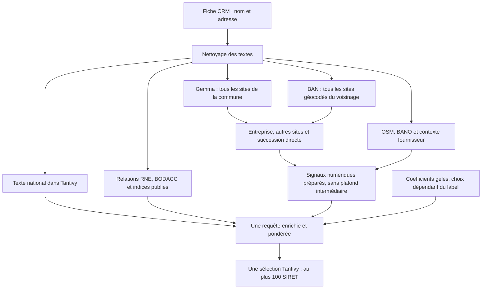

# Le moteur qui a produit 507/526 — lecture du 14 octobre 2026



**Réponse courte : oui, il existe déjà une recherche de voisins sans obligation de nom commun.** Elle prend tous les établissements ayant des coordonnées utilisables dans une zone autour de l'adresse résolue. Ensuite, ces établissements concourent pour les 100 places. Cela ne garantit ni tous les occupants d'une adresse, ni les 100 établissements les plus proches. BANO et OSM renforcent les références numériques déjà préparées ; ils ne déclenchent pas une nouvelle collecte nationale de voisins. Preuves : `scripts/embeddinggemma2_v21_relation_views.py:136-174`, `scripts/embeddinggemma2_v142_bano_native_ablation.py:153-215`.

| Voie | Cherche quoi | Active ? | Apport mesuré |
|---|---|---|---|
| Texte Tantivy : noms | Noms légaux, commerciaux, de site, historiques et documentaires ; France entière | Oui | Attribution des succès non disponible sans relance |
| Texte Tantivy : adresse et commune | Mots de l'adresse, fragments de caractères, CP ou INSEE ; sans nom obligatoire | Oui ; poids variable | Attribution non disponible sans relance |
| Gemma site et entreprise | Ressemblance du texte CRM avec les sites de la commune et les noms de leur entreprise | Oui, vecteurs réutilisés | 2 554 848 sites des 295 communes préparés ; pas un nombre de succès attribués |
| Géographie BAN | Tous les établissements géocodés dans la zone, sans filtre de nom | Oui si position utilisable | 863 633 références requête–site, 462 requêtes non vides ; contribution aux 507 inconnue |
| Autres sites de l'entreprise et successions SIRENE | Tous les sites nationaux des entreprises repérées, puis une succession directe et la famille cible | Oui | Univers numérique final : 128 313 036 références requête–site, avec recouvrements |
| Noms publics sectoriels d'entreprise | Noms d'organismes propriétaires, diffusés à leurs sites nationaux | **Poids nul dans les cinq modèles** | Contribution au score : zéro |
| Acteurs et relations RNE | Nom d'une entreprise dirigeante, parties reliées ou partageant un acteur | Oui | Expansion relationnelle combinée : 267 requêtes, 1 040 933 références requête–entreprise |
| Mère annoncée BODACC et groupe publié | Nom de mère annoncé ; membres d'un groupe daté | Oui, contexte limité | Inclus dans l'expansion précédente ; gain propre non disponible |
| Activités BODACC | Mots CRM dans l'activité publiée d'une entreprise | Oui, CP/INSEE requis | 433 requêtes, 12 641 678 références requête–entreprise ; succès propres inconnus |
| Initiales de noms officiels | Sigles dérivés des noms d'entreprise ou de site | Oui, CP/INSEE requis | Contribution propre non disponible sans relance |
| Fournisseur → marques clientes | Publication fournisseur et noms publics de ses clients ; pas identité juridique certifiée | Oui, 19 requêtes déclenchées | Ajout fournisseur site seul : +1 exact / 0 perte ; temporel seul : même +1 |
| Continuité économique + adresse propre | Compatibilité d'adresse entre deux sites officiellement liés | Oui, sur les mêmes références | +0 exact / 0 perte contre V115 |
| OSM : géométrie | Axe de rue ou point d'adresse publié | Oui, sur les mêmes références | +0 exact / 0 perte contre V115 |
| OSM : lieux nommés | Lieu portant les mots CRM, puis proximité aux sites publics déjà préparés | Oui | +1 exact / 0 perte contre V115 |
| RNA | Titre d'association ou initiales, jointure officielle à l'entreprise | Oui, CP/INSEE requis | 87 requêtes, 2 054 références d'entreprise ; +1 exact / 0 perte contre V115 |
| BANATIC | Groupement public, membre ou adhésion directement reliés | Oui, CP/INSEE requis | 40 requêtes, 3 364 références d'entreprise ; +0 exact / 0 perte contre V115 |
| BANO, uniquement observations OSM | Tous les points compatibles de l'adresse exacte, sinon de la rue exacte | Oui, renforcement sans expansion | 321 rues et 205 numéros couverts ; +0 exact / 0 perte en ajout au composite V134 |
| XGBoost, reranker, décideur, recherche web en direct | Reclassement ou décision après recherche | **Non** | Aucun apport au résultat décrit |

**Lire les nombres correctement.** Une référence requête–site compte un site une fois pour une requête. Le même site peut compter pour plusieurs requêtes. Les voies se recouvrent : ces nombres ne s'additionnent pas. « +1 » décrit une comparaison complète existante, pas l'origine de tous les succès. Les périmètres et preuves du tableau sont détaillés en §3 et §6 ; commandes de lecture en annexe.

## Repères, vocabulaire et niveau de preuve

Les définitions suivantes expliquent les termes techniques en cinq mots :

- **CRM** : fichier contenant les fiches clients. **SIREN** : identifiant français de neuf chiffres. **SIRET** : identifiant français de quatorze chiffres.
- **INSEE** : code identifiant une commune française. **CP** : code postal de cinq caractères.
- **Tantivy** : moteur local de recherche textuelle. **Index** : catalogue permettant une recherche rapide.
- **Gemma** : modèle transformant textes en vecteurs. **Vecteur** : liste numérique représentant un texte. **Cosinus** : mesure comparant deux vecteurs normalisés.
- **BAN** : base nationale officielle des adresses. **BANO** : base communautaire de positions d'adresses. **OSM** : carte collaborative contenant des lieux.
- **RNE** : registre national français des entreprises. **BODACC** : bulletin officiel des annonces commerciales. **RNA** : registre national français des associations. **BANATIC** : base nationale des groupements publics.
- **Score** : nombre mesurant une pertinence calculée. **Coefficient** : poids numérique appliqué au signal. **Collecteur** : sélection finale des meilleurs candidats.
- **Lambert-93** : projection française exprimée en mètres. **Partition** : découpage des entreprises en groupes. **OOF** : prédiction excluant son groupe d'apprentissage.
- **Label** : réponse humaine utilisée comme référence. **Ablation** : comparaison retirant ou ajoutant composant. **Quantification** : approximation numérique avec précision bornée.
- **Calibrateur** : apprentissage des poids du score. **Feature** : signal utilisé pour calculer score. **Pool** : liste intermédiaire de candidats retenus.
- **Empreinte** : résumé cryptographique vérifiant un contenu. **Bit** : unité binaire codant des nombres. **Namespace** : répertoire isolant les artefacts d'expérience.

**Lu dans le code** = comportement établi par les fonctions appelées. **Mesuré dans les sorties** = valeur déjà enregistrée ou simple comptage de ces fichiers. **Supposé** = hypothèse, pas résultat. **Inconnu** = preuve absente. Aucun `run`, `evaluate`, calcul de recherche, fichier de labels ni jeu fermé n'a été ouvert pour cette lecture. Les scores de référence proviennent des rapports existants, pas d'une nouvelle évaluation.

Chemins abrégés dans les références :

```text
H = /Volumes/CATNAT_DATA/SIRETO_EMBEDDINGGEMMA2
P = H/v142/bano_native_20261013_night
R = P/all_new_sources_max_bano
I = /Volumes/CATNAT_DATA/SIRETO_RECALL100/indexes/hierarchical_retrieval_v3/4b332899d8698354
```

### Run exact et appels réels

**Mesuré dans les sorties.** La commande enfant enregistrée, qui a produit la variante décrite, est :

```bash
# Commande historique, NE PAS exécuter dans cet audit.
.venv/bin/python -u -m scripts.embeddinggemma2_v142_bano_native_ablation generate \
  --output /Volumes/CATNAT_DATA/SIRETO_EMBEDDINGGEMMA2/v142/bano_native_20261013_night \
  --variant all_new_sources_max_bano
```

Référence : `R/owned_process.json:3-13`. Le reçu confirme la fin réelle avec code 0 (`R/generate_exit.json:2-6`). La recette exacte est `P/recipe.json`, liée par empreinte à `P/launch.json:4-13`. Son expression de combinaison figure dans `scripts/embeddinggemma2_v142_bano_native_ablation.py:24-49` : 58 coefficients gelés, 51 signaux numériques, précision 20 bits héritée, plafond 100, aucune nouvelle phase d'apprentissage.

**Lu dans le code.** Pour une requête recalculée, les appels sont :

```text
v142.generate
  → v115.native_search [ajoute activité BODACC]
  → v99.native_search [ajoute relations puis initiales]
  → v81.native_search [assemble la base et l'indice fournisseur lexical]
  → v32.native_query [base lexicale et 22 signaux numériques]
  → searcher.search(limit=100), à travers les enveloppes précédentes
  → v132.EvidenceCollector [ajoute MAX nouvelles sources + RNA/BANATIC]
  → searcher Tantivy réel
```

Preuves : `scripts/embeddinggemma2_v142_bano_native_ablation.py:218-312`, `scripts/embeddinggemma2_v115_streamed_activity_ablation.py:80-88`, `scripts/embeddinggemma2_v99_initial_alignment_native.py:176-189`, `scripts/embeddinggemma2_v81_indirect_lexical_query.py:92-133`, `scripts/embeddinggemma2_v32_native_features.py:107-135`, `scripts/embeddinggemma2_v132_local_evidence_ablation.py:236-262`. V143 charge réellement V132 et ne change que le namespace, le module enfant et le traitement des références vides (`scripts/embeddinggemma2_v143_empty_reference_continuation.py:12-33`). V129 prépare une source OSM ; V14 prépare les communes, textes et vecteurs. Ce ne sont pas des collecteurs supplémentaires dans V142.

**Mesuré dans les sorties.** V142 n'a pas recalculé 526 recherches : **107 recalculées, 419 sorties réutilisées**. Le code réutilise une sortie V134 uniquement si tous les scores ajoutés sont identiques et les contextes d'entreprise inchangés ; sinon V115 uniquement si l'ajout est exactement nul. Il ne choisit pas selon le succès humain (`scripts/embeddinggemma2_v142_bano_native_ablation.py:259-294`, `R/generation.json:20-21`). Ce run n'établit donc pas un nouveau temps complet de service.

## 1. Entrée : quels champs, quel nettoyage ?

**Lu dans le code.** L'entrée scellée contient exactement `query_id`, `fold`, `crm_name`, `crm_number`, `crm_suffix`, `crm_street`, `crm_postcode`, `crm_insee`. Les deux premiers servent au suivi et à l'évaluation, pas à comparer les entreprises. Il n'y a **ni ville en texte, ni latitude/longitude CRM, ni SIREN cible** dans cette fiche (`src/xgb_matcher/retrieval_query_population_v192.py:18-28`, `src/xgb_matcher/retrieval_query_ban_v327.py:18-24`). Le nom et les codes sont ceux du panel préparé ; V142 n'est pas une nouvelle importation CSV.

- **Nom/adresse pour Tantivy** : suppression préalable des chaînes ressemblant à des identifiants, puis majuscules, accents retirés et ponctuation remplacée par des espaces. Adresse = numéro + suffixe + rue. Recherche par mots et par fragments de 3 à 5 caractères (`scripts/embeddinggemma2_v2_data.py:26-32`, `src/xgb_matcher/hierarchical_retrieval.py:30-35`, `src/xgb_matcher/hierarchical_retrieval.py:68-80`, `scripts/embeddinggemma2_v23_native_features.py:316-331`). Le CP et l'INSEE sont comparés séparément ; ils ne sont pas collés à la rue dans cette voie.
- **Pour Gemma** : texte `noms: … adresse: … CP`. La vue entreprise utilise seulement `noms: …`. Pas de reformulation par un assistant ; les identifiants contenus dans le texte sont retirés (`scripts/embeddinggemma2_compare.py:41-42`, `scripts/embeddinggemma2_night.py:69-74`, `scripts/embeddinggemma2_v19_proof_retrieval.py:172-173`).
- **Comparaisons de nom et rue** : retrait des formes juridiques et de `ND`, conversion de `&` en `ET`, expansion des abréviations de rue. Le nettoyage n'est **pas unique** pour toutes les voies. Le numéro peut aussi être extrait du début de la rue ; un suffixe absent réduit la preuve, il n'est pas inventé (`scripts/embeddinggemma2_v17_structural_retrieval.py:51-67`, `scripts/embeddinggemma2_v2_data.py:34-39`, `scripts/embeddinggemma2_v19_proof_retrieval.py:47-83`).
- **Position de l'adresse** : tirée de BAN, pas de coordonnées CRM. Premier rapprochement : même numéro et INSEE ou CP ; choix préférant INSEE, ressemblance de rue puis certification. Ce premier choix ne rejette pas une rue par un seuil minimal explicite. Position faible = preuve atténuée. En cas d'absence, recherche d'une rue BAN : seuil 0,90 et écart minimal 0,03 avec la concurrente ; tous ses points servent à une zone de rue, jamais à une maison imaginaire (`scripts/run_retrieval_geo_v16_workbench.py:85-133`, `src/xgb_matcher/retrieval_geo_v16.py:170-227`, `scripts/embeddinggemma2_v17_structural_retrieval.py:71-108`, `scripts/embeddinggemma2_v17_structural_retrieval.py:134-164`).

## 2. Ce qui est indexé

**Mesuré dans le manifeste.** L'index contient **82 772 691 documents** : **43 896 818 établissements** et **38 875 873 documents d'entreprise**. Un document établissement porte un SIRET ; un document entreprise porte un SIREN. La sortie V142 impose le type établissement. Elle ne retourne pas les documents d'entreprise (`I/manifest.json:13-18`, `scripts/embeddinggemma2_v81_indirect_lexical_query.py:123-128`). Le constructeur actuel a exactement l'empreinte du manifeste : vérification en annexe.

**Lu dans le code.** Les champs stockés sont : identifiants, INSEE, CP, numéro, état actif/fermé, siège ; noms légaux, commerciaux et de site ; anciens noms et noms documentaires ; adresses courantes, historiques et documentaires ; champs séparés SIRENE/RNE/BODACC ; liens et références des preuves. **Pas de champ de coordonnées dans Tantivy** : elles viennent de tableaux nationaux séparés (`scripts/build_hierarchical_retrieval_index.py:296-336`, `scripts/build_hierarchical_retrieval_index.py:431-531`).

Tous les anciens noms ne sont pas garantis dans l'index. Le constructeur limite les variantes selon leur rôle et leur priorité. Politique : 4 noms légaux et 8 commerciaux par entreprise ; 6 noms de site par établissement ; 6 historiques par site et 12 par entreprise ; 4 documentaires par site et 6 par entreprise. Les anciennes adresses sont limitées à 8, les documentaires à 6 (`config/siren_name_portfolio_v1.json:9-33`, `src/xgb_matcher/siren_dossier.py:993-1036`, `src/xgb_matcher/siren_dossier.py:1077-1105`). Les mots peuvent chercher les historiques/documentaires. Les fragments de nom sont construits **seulement sur les noms courants**, ceux d'adresse seulement sur les adresses courantes (`scripts/build_hierarchical_retrieval_index.py:519-530`).

**Établissements fermés : oui.** La sélection des établissements vérifie les identifiants, pas l'état actif. Le constructeur conserve cet état. Les 58 champs utilisés par ce run n'incluent pas de préférence actif/fermé ; la politique opérationnelle reste une autre mesure (`src/xgb_matcher/siren_dossier.py:278-302`, `scripts/build_hierarchical_retrieval_index.py:470-478`, `H/v71/frozen_residual_20261013_a/calibration/model_0.json:2-60`).

**Diffusion partielle : oui, les lignes ne sont pas exclues de l'index.** Le dossier n'applique pas de filtre de diffusion à la population des établissements. Le statut de diffusion n'est pas un champ de ce schéma Tantivy. Il conserve les valeurs effectivement publiées, y compris des marqueurs `ND`, plus les preuves officielles liées déjà disponibles ; ce n'est pas une reconstitution des champs masqués (`src/xgb_matcher/siren_dossier.py:278-302`, `src/xgb_matcher/siren_dossier.py:929-935`, `scripts/build_hierarchical_retrieval_index.py:339-346`, `scripts/build_hierarchical_retrieval_index.py:431-531`).

**Mesuré, échantillon de source seulement.** Sur les 100 premières lignes du stock à diffusion `P`, les 100 existent dans les documents source de l'index ; 62 sont fermées. Les 100 ont une adresse constituée de marqueurs `ND`, un numéro masqué, un CP masqué et un nom de site `ND`. 93 ont aussi le nom légal `ND`. Les 100 conservent un INSEE non vide/non masqué. Cela ne décrit pas toutes les lignes à diffusion partielle. Aucun nom ni identifiant de cet échantillon n'est publié ici ; commande en annexe B.

**Protection distincte des nouvelles voies.** OSM/BANO et les ajouts fournisseur/adresse exigent une diffusion publique **de l'établissement et de l'entreprise** pour leurs coordonnées/contexte. Ils ne rendent pas les lignes partielles absentes du texte national (`scripts/embeddinggemma2_v132_local_evidence_ablation.py:132-151`, `scripts/embeddinggemma2_v142_bano_native_ablation.py:153-175`, `scripts/embeddinggemma2_v133_supplier_site_context.py:96-105`, `scripts/embeddinggemma2_v137_continuity_address_source.py:99-109`). **Inconnu :** exhaustivité nationale des champs utiles des lignes partielles, non mesurée dans cet audit.

## 3. Voies : ce qu'elles font, où, et avec quel plafond

**Lu dans le code. Il n'existe pas de quota « 10 candidats par source ».** Les voies donnent des clauses de recherche et des scores. Leur réunion est évaluée avant la seule sélection des 100. Les mesures de couverture ci-dessous sont celles du tableau et de l'annexe, pas des listes indépendantes de candidats finaux.

1. **Texte national.** Quatre signaux : mots du nom, fragments du nom, mots d'adresse, fragments d'adresse. Pour les mots, le meilleur champ de nom ou d'adresse est retenu, pas la somme des répétitions du même alias. Cinquième signal : INSEE ou CP, meilleur des deux. Tous sont facultatifs les uns par rapport aux autres. Même une correspondance administrative seule peut admettre un établissement. Pas de restriction obligatoire à la commune sur la branche originale (`scripts/embeddinggemma2_v23_native_features.py:316-331`, `scripts/retrieval_v38_initial_top100.py:45-56`, `scripts/embeddinggemma2_v32_native_features.py:118-135`).
2. **Gemma et preuves de site.** Tous les établissements indexés de chaque commune CRM sont encodés/préparés, pas seulement un top100. Le score de site est la meilleure ressemblance parmi ses textes, découpés en vues de 512 unités de texte du modèle. Le score entreprise compare le nom CRM aux noms officiels de l'entreprise et de ses autres sites, sans copier leurs adresses au site candidat. Ces vecteurs ne sont pas nationaux : ils couvrent les communes préparées (`scripts/embeddinggemma2_v14_full_pipeline.py:167-207`, `scripts/embeddinggemma2_v18_identity_retrieval.py:112-152`, `scripts/embeddinggemma2_v19_proof_retrieval.py:147-193`, `scripts/embeddinggemma2_v2_data.py:112-120`).
3. **Géographie et familles.** Scan des 43 896 818 coordonnées alignées aux SIRET. Tous les sites dans la zone sont retenus, avant tout plafond. Leur preuve géographique contient aussi une ressemblance de nom, mais une part positive de distance subsiste sans nom. Toutes les entreprises touchées par la commune ou ce scan sont ensuite développées vers tous leurs sites nationaux. Une succession économique directe peut ajouter une entreprise cible et tous ses sites ; pas de deuxième lien (`scripts/embeddinggemma2_v21_relation_views.py:136-174`, `scripts/embeddinggemma2_v23_native_features.py:214-259`). Un site ajouté hors commune n'acquiert pas artificiellement un cosinus Gemma de site ; son propre signal peut être nul.
4. **Successions officielles SIRENE.** Liens utilisés dans les deux sens, continuité économique vraie, date connue ≤ 1er août 2026. Proximité entre extrémités et ancienneté sont des signaux distincts. Les dates inconnues/futures ne passent pas. Les noms du prédécesseur ne deviennent pas un alias propre du successeur (`scripts/embeddinggemma2_v23_native_features.py:99-121`, `scripts/embeddinggemma2_v23_native_features.py:168-173`, `scripts/embeddinggemma2_v23_native_features.py:252-257`).
5. **Noms publics sectoriels.** Noms d'entreprise propriétaire, pas noms de ses équipements empruntés. Branche nationale calculée, mais coefficient égal à **0 dans chacun des cinq modèles réellement référencés**. Donc aucune contribution de cette branche au score final (`scripts/embeddinggemma2_v32_native_features.py:52-73`, `scripts/embeddinggemma2_v32_native_features.py:75-101`, `P/calibration/generation.json:3-34`, modèles `H/v71/frozen_residual_20261013_a/calibration/model_{0..4}.json:62-69`).
6. **RNE.** Première branche nationale : mots du nom CRM dans le nom d'une entreprise acteur d'un rôle légal. Les mots rares pèsent davantage ; meilleur acteur retenu par entreprise sujet. Pas d'obligation de commune sur cette branche. Autres signaux : rôle × coordonnées/adresse propres, seulement sur les références numériques préparées. Enfin, expansion par un rôle direct ou un acteur commun : la branche ajoutée exige **INSEE ou CP du CRM**. Ce n'est pas une preuve de propriété ou d'identité ; les personnes physiques ne sont pas utilisées comme acteurs (`scripts/embeddinggemma2_v56_corporate_site.py:118-135`, `scripts/embeddinggemma2_v56_corporate_site.py:175-201`, `scripts/embeddinggemma2_v56_corporate_site.py:205-239`, `scripts/embeddinggemma2_v88_typed_context_native.py:88-114`, `scripts/embeddinggemma2_v99_initial_alignment_native.py:107-135`).
7. **Mère BODACC, groupe et initiales.** Mère : nom publié attaché au sujet structuré de l'annonce, pas une entreprise mère résolue par homonymie. Groupe : une publication datée de fin 2021, 53 entités françaises avec racine, **pas tous les groupes français**. Ces noms servent de contexte, avec soutien d'adresse propre ou branche administrative. Initiales : alignements dérivés de noms officiels ; elles ne sont pas déclarées vrais sigles. Pas de quota intermédiaire d'entreprises/sites (`scripts/embeddinggemma2_v71_frozen_residual.py:40-51`, `scripts/embeddinggemma2_v71_frozen_residual.py:96-139`, `scripts/embeddinggemma2_v88_typed_context_native.py:115-137`, `scripts/embeddinggemma2_v99_initial_alignment_native.py:142-168`).
8. **Activité BODACC.** Cherche les mots informatifs CRM dans les activités publiées jusqu'au 1er août 2026. Seuls objets structurés attribuables à une entreprise publique et un établissement sont lus ; les structures complexes ne sont pas inventées. Les mots peuvent provenir de plusieurs annonces d'une même entreprise. Confiance plafonnée à 0,5, renforcée par rareté des mots ; tous les sites de cette entreprise correspondant au CP ou INSEE peuvent concourir, sans budget de sites (`scripts/embeddinggemma2_v112_bodacc_activity_context.py:29-38`, `scripts/embeddinggemma2_v112_bodacc_activity_context.py:55-99`, `scripts/embeddinggemma2_v114_native_activity_ablation.py:97-120`, `scripts/embeddinggemma2_v115_streamed_activity_ablation.py:80-87`).
9. **Fournisseur publié.** Une publication archivée et sa section de marques clientes, **pas un annuaire exhaustif de tous les fournisseurs**. Déclenchement quand tous les mots du fournisseur sont dans le CRM. Branche lexicale : noms courants des entreprises publiques clientes, avec INSEE ou CP obligatoire. Signaux numériques : confiance faible × adresse/géographie propre, sur l'univers existant. Ajout V133 : sites de ces entreprises puis lien économique direct, avec distance entre les deux sites. Ajout V137 : adresses propres compatibles, même commune et même rue, numéros identiques quand connus ; numéro absent donne une preuve moindre. Aucun nom/adresse transféré entre occupants (`scripts/embeddinggemma2_v75_published_supplier_context.py:24-39`, `scripts/embeddinggemma2_v75_published_supplier_context.py:65-124`, `scripts/embeddinggemma2_v81_indirect_lexical_query.py:106-122`, `scripts/embeddinggemma2_v133_supplier_site_context.py:61-64`, `scripts/embeddinggemma2_v133_supplier_site_context.py:118-144`, `scripts/embeddinggemma2_v137_continuity_address_source.py:52-61`, `scripts/embeddinggemma2_v137_continuity_address_source.py:132-152`).
10. **OSM local.** Source communautaire déjà téléchargée et préparée. Voisinage de **2 km** autour de la position BAN/de rue ; tampon de **3,5 km** pour assembler les géométries. Géométrie : axe de rue seulement si la requête a une précision de rue ; point d'adresse si rue, numéro et suffixe exacts. Lieu nommé : tous les mots informatifs du CRM doivent figurer dans **une même variante** `name`, `brand`, `alt_name`, `official_name`, `short_name` ou `old_name`, pas `operator`. Bonus selon distance au lieu. Bâtiments exportés par la source, mais pas de voie autonome « tous occupants du bâtiment » dans V142. Les bonus ne portent que sur les sites publics de l'univers numérique préexistant (`scripts/embeddinggemma2_v129_osm_local_source.py:46-73`, `scripts/embeddinggemma2_v129_osm_disk_source.py:124-132`, `scripts/embeddinggemma2_v132_local_evidence_ablation.py:194-228`). Le changement V129 catégorie préserve des géométries différentes pour un même objet (`scripts/embeddinggemma2_v129_osm_disk_category_source.py:16-42`).
11. **RNA et BANATIC.** RNA : titre/court titre officiel ou initiales dérivées de 3 à 8 mots, puis correspondance officielle RNA–SIREN. BANATIC : nom d'organisme puis une relation directe de membre/adhésion, dans les deux sens ; pas identité du voisin. Noms/mots exigés pour déclencher ces sources ; les sites candidats doivent correspondre au CP ou INSEE. Confiance 0,5 réduite quand plusieurs propriétaires/voisins conviennent. Aucun plafond propre de sites (`scripts/embeddinggemma2_v130_structural_evidence.py:43-58`, `scripts/embeddinggemma2_v130_structural_evidence.py:86-97`, `scripts/embeddinggemma2_v130_structural_evidence.py:148-191`, `scripts/embeddinggemma2_v130_banatic_memberships.py:29-39`, `scripts/embeddinggemma2_v130_banatic_memberships.py:136-160`, `scripts/embeddinggemma2_v132_local_evidence_ablation.py:250-262`).
12. **BANO.** Scan national de l'archive, seules lignes de provenance exacte `OSM` admises. Acheminement : INSEE courant ; INSEE délégué et chef-lieu ; sinon toutes les communes publiées du CP. Rue exactement normalisée ; tous les numéros/suffixes exacts si présents, sinon tous les points de la rue. Pas de point unique choisi au vu du label, pas de centre de rue transformé en maison. Distance minimale aux points ; renforcement géographique sur les mêmes références, sans rayon de nouvelle admission. Le signal géographique augmente jusqu'à `0,5/(1+distance/300)` s'il était inférieur. Trois lignes source mal formées ont été isolées, pas réparées (`scripts/embeddinggemma2_v141_bano_national_source.py:110-139`, `scripts/embeddinggemma2_v141_bano_quarantined_source.py:25-53`, `scripts/embeddinggemma2_v142_bano_native_ablation.py:123-141`, `scripts/embeddinggemma2_v142_bano_native_ablation.py:180-208`).

**Limite de date, lue dans la recette.** Ces sources ne sont pas toutes admissibles pour une preuve historique/production : BAN du 14 août, OSM communautaire courant, BANATIC du 5 août et publication fournisseur limitée restent diagnostiques. Le run autorise leur étude, pas une promotion (`src/xgb_matcher/retrieval_query_ban_v327.py:14-15`, `scripts/embeddinggemma2_v130_banatic_memberships.py:29-31`, `scripts/embeddinggemma2_v142_bano_native_ablation.py:42-49`).

## 4. Recherche par adresse : tous les voisins, vraiment ?

**Oui pour l'admission géographique préparée, non pour une sortie exhaustive.** Le scan national V21 n'exige ni nom, ni commune du candidat. Il exige une position CRM résolue et compatible avec Lambert-93, puis des coordonnées établissement finies dans le domaine métropolitain utilisé (`scripts/embeddinggemma2_v21_relation_views.py:140-157`).

Le rayon n'est **pas toujours 300 m** :

- adresse BAN ordinaire : `max(300 m si forte, 1 000 m si faible, 3 × incertitude)` ;
- rue de remplacement : cercle autour de la moyenne de ses points, rayon `distance du point le plus éloigné + 300 m`.

Pas de plafond d'établissements à cette étape (`scripts/embeddinggemma2_v21_relation_views.py:52-57`, `scripts/embeddinggemma2_v17_structural_retrieval.py:99-108`). **Mesuré sur les géométries enregistrées** : 466/526 positions compatibles ; rayons de 300 à 1 481,68 m, médiane 300 m. Le scan contient des sites pour 462/526 requêtes, médiane 286 et maximum 37 105 références par requête.

Le nom intervient dans la préférence, **pas dans l'obligation d'admission** : preuve de voisinage `0,90 × ressemblance du nom + 0,10/(1+distance/300)`. Autre signal : qualité géographique propre, décroissante avec la distance. Ces scores peuvent être positifs sans nom commun (`scripts/embeddinggemma2_v21_relation_views.py:166-173`, `scripts/embeddinggemma2_v23_native_features.py:234-241`). Les mots d'adresse et le CP/INSEE apportent aussi des voies sans nom (`scripts/embeddinggemma2_v23_native_features.py:316-331`).

**Ce que cela ne fait pas :** inventaire de tous les occupants d'une maison ; garantie d'exhaustivité quand coordonnées manquantes ; sélection obligatoire des plus proches ; nouvelle recherche de tous les voisins autour du point BANO ou du lieu OSM. Une entreprise sans nom commun mais proche est déjà admissible ; elle peut perdre face aux autres scores au plafond 100. L'inverse « le nom est toujours nécessaire » serait faux.

## 5. Score et sélection des 100

### Une somme, avec des maxima locaux

**Lu dans le code.** Chaque établissement reçoit une somme pondérée, pas un vote majoritaire ni une fusion de listes top100. Les coefficients sont non négatifs. Il y a **7 composantes de recherche + 51 signaux numériques**, soit 58 coefficients (`scripts/embeddinggemma2_v71_frozen_residual.py:33-39`, `scripts/embeddinggemma2_v81_indirect_lexical_query.py:92-104`).

Les signaux couvrent : texte de nom/adresse, commune ; cosinus site/entreprise ; ressemblance de nom/rue et preuve de numéro ; distance propre ; noms des autres sites comme contexte d'entreprise ; succession ; acteur légal et adresse propre ; coordonnées publiques complétées par BAN ; interactions de ces signaux. Une interaction est leur produit : par exemple, ressemblance du nom × proximité (`scripts/embeddinggemma2_v23_native_features.py:30-36`, `scripts/embeddinggemma2_v23_native_features.py:214-259`, `scripts/embeddinggemma2_v71_frozen_residual.py:127-139`, `scripts/embeddinggemma2_v68_filled_site_geo.py:66-96`).

Les nouvelles sources ajoutent **le maximum**, pour chaque site, de : amélioration BANO, amélioration géométrique OSM, lieu OSM nommé, fournisseur propre/temporel, continuité d'adresse. Elles ne cumulent pas cinq bonus sur le même site. RNA et BANATIC sont fusionnés par maximum de confiance pour chaque entreprise. Cet ajout reste additionné à la base et aux contextes hérités ; il ne supprime pas toute répétition possible entre anciennes preuves (`scripts/embeddinggemma2_v142_bano_native_ablation.py:261-279`, `scripts/embeddinggemma2_v132_local_evidence_ablation.py:236-262`).

**Mesuré dans les modèles.** Quelques plages de poids, sur les cinq modèles : nom par mots 0,039–0,064 ; nom par fragments 0,079–0,111 ; commune/CP 1,030–1,146 ; cosinus site 1,440–1,654 ; cosinus entreprise 2,048–2,372 ; contexte acteur 1,306–1,961. Les valeurs des signaux n'ont pas toutes la même échelle : cela ne donne pas le classement de leur importance réelle. La branche noms publics sectoriels a un poids nul partout. Plusieurs autres signaux sont également nuls dans tout ou partie des modèles (`H/v71/frozen_residual_20261013_a/calibration/model_{0..4}.json:62-121`). **Inconnu :** décomposition fidèle des scores des 507 succès.

### D'où viennent les coefficients ?

**Lu dans le code et mesuré dans les métadonnées.** L'apprentissage V32 compare le site humain d'une requête d'apprentissage à des concurrents. Il cherche des poids donnant un score plus élevé au premier. Concurrents : jusqu'à 12 forts par signal numérique, 32 tirés dans cet univers, ancien résultat lexical national100, et concurrents nom public/administration101. Ce sont des exemples d'apprentissage, **pas un pool produit**. Les requêtes ont leurs poids de tirage par commune. L'échelle des signaux est calculée seulement dans l'apprentissage ; pénalisation des poids à 0,01 (`scripts/embeddinggemma2_v32_learned_query.py:31-46`, `scripts/embeddinggemma2_v32_learned_query.py:95-109`, `scripts/embeddinggemma2_v32_learned_query.py:140-174`).

Cinq partitions internes sont calculées par empreinte du **SIREN humain**, sur les seules requêtes folds 2/3/4. Chaque modèle apprend sur les autres partitions ; aucune même entreprise humaine dans apprentissage et partition évaluée. Les groupes exposés aux contrôles du modèle Gemma sont exclus de l'apprentissage du calibrateur, conservés dans la mesure finale (`scripts/embeddinggemma2_v32_learned_query.py:117-124`, `scripts/embeddinggemma2_v32_learned_query.py:177-197`). Ces cinq numéros internes 0…4 **ne sont pas les folds fermés 0/1**.

V71 conserve les 28 coefficients V32 et apprend 30 coefficients additionnels avec la marge V32 fixée. Ce n'est pas un nouvel apprentissage conjoint des 58. La marge de base dans cet apprentissage additionnel est issue des données d'apprentissage de base, pas d'une validation interne supplémentaire (`scripts/embeddinggemma2_v71_frozen_residual.py:38-47`, `scripts/embeddinggemma2_v71_frozen_residual.py:150-168`, `H/v71/frozen_residual_20261013_a/calibration/model_0.json:123-131`). Ensuite les sources fournisseur, relations supplémentaires, activité, RNA, BANATIC, OSM et BANO utilisent ces coefficients **sans nouvel apprentissage** ; beaucoup empruntent le coefficient acteur numéro 6.

Les modèles effectivement liés sont les cinq `H/v71/frozen_residual_20261013_a/calibration/model_*.json`, pas un modèle entraîné en V142 (`P/calibration/generation.json:3-34`). Comptes apprentissage/partition évaluée : **284/124, 298/109, 314/81, 296/104, 308/108**. Le modèle Gemma utilisé en amont est l'adaptateur V6 `best_adapter.pt`, étape 1000 pour les caches repris ; pas de réentraînement dans ce run (`scripts/embeddinggemma2_v19_proof_retrieval.py:133-162`). La mesure n'est pas une OOF complète du modèle Gemma : 151 requêtes appartiennent à des entreprises exposées aux contrôles de choix du modèle ; tout le panel a servi au développement (`docs/retrieval_scientific_validity_all526_20261014.json:5-13`).

### Défaut connu : le modèle choisi dépend de la réponse humaine

**Établi, pas une hypothèse.** L'affectation est : empreinte de `seed + '|' + label.siren`, modulo 5. V142 lit cette affectation puis choisit les coefficients correspondants, **aussi pour préparer les améliorations BANO** (`scripts/embeddinggemma2_v32_learned_query.py:122`, `scripts/embeddinggemma2_v142_bano_native_ablation.py:161-175`, `scripts/embeddinggemma2_v142_bano_native_ablation.py:247-250`). Le worker ne lit pas les labels bruts, mais consomme une décision calculée avec eux.

La séparation des entreprises pour mesurer les coefficients reste une précaution utile. **Elle ne fournit pas une règle utilisable en production** : pour une fiche inconnue, le SIREN humain est justement ce qu'on cherche. Le run 507/526 ne démontre pas qu'un choix de coefficients sans label ferait pareil. Il faut distinguer ce défaut du fait, différent, que le SIREN n'est pas une feature de score (`docs/retrieval_scientific_validity_all526_20261014.json:25-30`).

### Comment arrive le plafond ?

Les scores numériques sont approximés sur **20 bits**, puis attachés aux SIRET/SIREN par clauses de recherche. Les identifiants servent d'adresses de jointure, pas de nombres prédictifs. Les enveloppes ajoutent leurs clauses avant l'appel réel `search(limit=100)`. Elles ne prennent pas chacune 100 résultats (`scripts/embeddinggemma2_v32_native_features.py:120-135`, `scripts/embeddinggemma2_v81_indirect_lexical_query.py:98-104`, `scripts/embeddinggemma2_v132_local_evidence_ablation.py:240-262`).

La sélection ne retourne que les établissements. Ensuite seulement, les résultats déjà choisis sont triés par score décroissant, puis SIRET pour les égalités. Le tri ne revoit pas les égalités en dehors des 100 retournés. Le code vérifie unicité et plafond (`scripts/embeddinggemma2_v81_indirect_lexical_query.py:123-131`, `scripts/embeddinggemma2_v142_bano_native_ablation.py:306-312`). **Mesuré : 526 listes de exactement 100, soit 52 600 résultats.** Aucun reclassement aval n'a produit ce résultat.

## 6. Contribution mesurée : ce qu'on peut réellement attribuer

**Mesuré dans les sorties.** Rapport de la variante `learned_native_ooc` : **507/526 exacts (96,39 %)**, **511/526 entreprises**, **508/526 opérationnels**. Exact pondéré par le tirage géographique : **95,68 %**. Les mesures restent séparées (`R/report.json:755-767`). Ce sont des résultats de développement, pas une validation nationale ni une atteinte du seuil 99,2 %.

**Pour les 507 succès, par quelle(s) voie(s) le SIRET humain est-il arrivé ? — non disponible sans relance.** `outputs.json` ne contient que `siret`, `siren`, `score` pour les candidats actuels. Les fichiers par requête ajoutent modèle, coût et éventuelle équivalence, pas une décomposition des preuves de chaque candidat (`scripts/embeddinggemma2_v142_bano_native_ablation.py:301-302`, `scripts/embeddinggemma2_v81_indirect_lexical_query.py:128`). Des statistiques de branches existent, mais pas le croisement candidat humain × voies. Aucun label n'a été ouvert pour tenter de le fabriquer.

**Ce qui existe à la place : comparaisons complètes enregistrées.** Contre V115, qui fait 504 exacts : OSM nommé seul fait 505 ; RNA seul 505 ; leur combinaison 506 ; fournisseur propre seul et temporel seul font chacun 505 et récupèrent le même dossier ; continuité d'adresse, géométrie OSM et BANATIC seuls restent à 504. Le composite V134 fait 507, trois gains et aucune perte. BANO ajouté à ce composite reste à 507, zéro gain/zéro perte (`scripts/embeddinggemma2_v134_supplier_native_ablation.py:174-195`, `scripts/embeddinggemma2_v142_bano_native_ablation.py:410-426`, `R/report.json:1219-1257` ; rapports d'ablations lus en annexe A).

Le handoff documente les trois gains comme GEDIMAT/OSM, EBSN/RNA et un NAOS/fournisseur (`docs/HANDOFF_CLAUDE.md:19-21`). Ce récit n'est pas une attribution exhaustive des 507. **Un ajout sans gain de recall peut néanmoins changer des scores ou des concurrents.** Inversement, réutiliser une sortie ancienne n'est pas un nouveau succès indépendant.

## 7. Ce qui manque structurellement — et ce qui est seulement inconnu

**Établi dans le code :**

- **SIRET absent de l'index** : impossible à retourner, même s'il existe dans une source annexe. Les clauses de référence ne créent pas de document (`scripts/embeddinggemma2_v81_indirect_lexical_query.py:123-128`, `scripts/embeddinggemma2_v132_local_evidence_ablation.py:246-262`).
- **Cible hors des communes préparées, hors zone géographique, sans famille/succession/contexte admissible** : pas de vecteur site Gemma national pour la récupérer. Il reste le texte national et les branches nationales d'entreprise/acteur ; pas une recherche vectorielle de toute la France (`scripts/embeddinggemma2_v19_proof_retrieval.py:143-175`, `scripts/embeddinggemma2_v23_native_features.py:214-224`).
- **Ni texte utile, ni proximité mesurable, ni contexte source accessible** : aucune preuve discriminante pour préférer cette entreprise. Cela n'interdit pas une arrivée faible par CP/INSEE ; cela interdit de prétendre que le moteur connaît une relation commerciale invisible (`scripts/embeddinggemma2_v23_native_features.py:316-331`).
- **Adresse physique non géocodée ou hors domaine Lambert-93 compatible** : pas d'admission par le scan de distance. OSM/BANO ne remplacent pas l'univers initial par tous les voisins de leurs points ; coordonnées BAN complémentaires n'agissent que sur les références préparées (`scripts/embeddinggemma2_v21_relation_views.py:145-157`, `scripts/embeddinggemma2_v68_filled_site_geo.py:66-96`, `scripts/embeddinggemma2_v142_bano_native_ablation.py:180-208`).
- **Champs masqués** : ils ne deviennent pas des noms/adresses utiles par magie. Les nouvelles voies protégées refusent de reconstituer les coordonnées d'une unité non publique. Présence d'une ligne et possibilité de l'identifier sont deux choses distinctes (§2).
- **Ancien nom absent des champs retenus, et entreprise hors univers numérique préparé** : pas de recherche nationale dans l'intégralité du dictionnaire historique. Les variantes supplémentaires sur disque ne sont consultées que pour les entreprises atteintes par les voies préparées. Les fragments historiques ne sont pas indexés comme les fragments courants (`scripts/embeddinggemma2_v23_native_features.py:188-211`, `scripts/embeddinggemma2_v23_native_features.py:285-289`, `scripts/build_hierarchical_retrieval_index.py:519-525`).
- **Chaîne de plusieurs successions ou de plusieurs relations non supportées** : pas de parcours arbitraire de graphe ; la succession s'arrête au lien direct, les contextes ont leurs règles explicites (§3).
- **Occupant, payeur, siège et exploitant distincts** : aucune règle générale ne déduit le site de facturation voulu par le CRM. Un autre site national de la bonne entreprise peut concourir, mais une proximité seule n'identifie pas l'intention métier (`scripts/embeddinggemma2_v23_native_features.py:214-250`, `docs/HANDOFF_CLAUDE.md:39-53`).
- **Publication fournisseur, groupe ou formats BODACC hors du périmètre ingéré** : pas de couverture exhaustive de ces relations (§3, points 7–9). Pas d'appel web pendant cette génération pour combler une absence.

**Important : ne pas transformer ces limites en diagnostic des 19 ratés.** Même avec une preuve accessible, un établissement peut finir au-delà de 100. La cause exacte peut être accès aux données, score ou compétition ; ce document ne recalcule aucun rang perdu. **Supposé :** une extension générale d'anciens noms ou de géographie pourrait aider. **Inconnu :** son gain réel, et le résultat avec une règle de choix des coefficients indépendante du label.

## Annexe A — commandes de lecture réellement exécutées et chiffres observés

Les commandes ci-dessous lisent uniquement les sorties et métadonnées déjà présentes. Elles n'importent pas le moteur et ne consultent ni outcomes ni labels. Les lectures initiales ont aussi vérifié les références de lancement, modèles et recettes ; aucune source volumineuse n'a été chargée en entier, sauf petits JSON de sorties (18,8 Mo) et géométries (8,1 Mo).

```bash
PYTHONDONTWRITEBYTECODE=1 .venv/bin/python - <<'PY'
import json, pathlib, hashlib, statistics, ijson, resource
H = pathlib.Path('/Volumes/CATNAT_DATA/SIRETO_EMBEDDINGGEMMA2')
P = H/'v142/bano_native_20261013_night'; R = P/'all_new_sources_max_bano'
def read(p): return json.loads(p.read_text())
launch = read(P/'launch.json'); gen = read(R/'generation.json')
print('commande', read(R/'owned_process.json')['command'])
print('sortie', read(R/'generate_exit.json')['exit_code'])
report = read(R/'report.json')['variants']['learned_native_ooc']
print('mesures', report['raw_sample'], report['weighted']['exact']['poststratified_hajek_estimate'])
rows = read(R/'outputs.json')['learned_native_ooc']
print('listes', len(rows), sum(map(len, rows.values())), min(map(len, rows.values())), max(map(len, rows.values())))
print('champs', sorted({k for cs in rows.values() for row in cs for k in row}))
t = read(R/'native_timings.json')
print('réutilisées/recalculées', sum(x['unchanged_outputs_reused'] for x in t.values()), gen['recomputed_queries'])
for k in ('full_nonlexical_leaves','activity_owner_context_references','typed_context_owner_expansions','indirect_lexical_expansion_used'):
    v = [x[k] for x in t.values()]
    print(k, 'nonvide/somme/min/médiane/max', sum(bool(x) for x in v), sum(v), min(v), statistics.median(v), max(v))
counts = []
with open(launch['geo_sources']['path'], 'rb') as f:
    for _, values in ijson.kvitems(f, '', use_float=True): counts.append(len(values))
print('geo', len(counts), sum(counts), counts.count(0), statistics.median(counts), max(counts))
radii = []
for row in read(pathlib.Path(launch['geometry']['path'])):
    g = row['geometry']
    if g['spatial_crs_compatible']:
        radii.append(g.get('footprint_radius_m', max(1000 if g['ban_declared_weak'] else 300, 3*max(0,g['ban_uncertainty_m']))))
print('rayons', len(radii), min(radii), statistics.median(radii), max(radii))
for name in ('outputs','timings'):
    ref = gen[name]
    print('empreinte', name, hashlib.sha256(pathlib.Path(ref['path']).read_bytes()).hexdigest() == ref['sha256'])
refs = {r['path']:r for r in [launch['implementation'], *launch['helpers']] if r['path'].endswith('.py')}
print('helpers conformes', sum(hashlib.sha256(pathlib.Path(p).read_bytes()).hexdigest()==r['sha256'] for p,r in refs.items()), len(refs))
manifest = read(pathlib.Path(launch['index_manifest']['path']))
print('index', manifest['num_documents'], manifest['num_establishment_documents'], manifest['num_siren_documents'])
print('constructeur conforme', hashlib.sha256(pathlib.Path('scripts/build_hierarchical_retrieval_index.py').read_bytes()).hexdigest()==manifest['builder_sha256'])
cal = read(P/'calibration/generation.json')
for fold, ref in cal['models'].items():
    m = read(pathlib.Path(ref['path']))
    print('modèle', fold, len(m['train_queries']), len(m['heldout_queries']), m['coefficients'][5])
for root, variants in [
 ('v134/supplier_native_20261013_night', ['supplier_own_site_only','supplier_temporal_only','continuity_address_only','all_new_sources_max']),
 ('v143/local_evidence_empty_recovery_20261013_night', ['geometry_only','named_places_only','osm_max','rna_only','osm_max_rna','banatic_only','osm_max_rna_banatic']),
 ('v142/bano_native_20261013_night', ['bano_geo_only'])]:
    for v in variants:
        d = read(H/root/v/'report.json'); pair = d['paired_vs_v115']
        print('ablation', v, d['variants']['learned_native_ooc']['raw_sample']['exact_hits'], len(pair['gains']), len(pair['losses']))
print('BANO incrémental', read(R/'report.json')['paired_vs_v134_all_new_sources_max']['exact'])
root = H/'v134/supplier_native_20261013_night'
print('même gain fournisseur', read(root/'supplier_own_site_only/report.json')['paired_vs_v115']['gains'] == read(root/'supplier_temporal_only/report.json')['paired_vs_v115']['gains'])
print('RSS octets', resource.getrusage(resource.RUSAGE_SELF).ru_maxrss)
PY
```

**Observé lors des lectures séparées correspondantes :** 507/511/508 ; pondéré 0,9567903499 ; 526 × 100 ; champs candidats uniquement score/SIREN/SIRET ; 419/107 ; empreintes outputs et timings conformes ; 28/28 helpers Python conformes ; constructeur conforme. Numérique : 522 requêtes non vides, somme 128 313 036, médiane 139 432,5, maximum 1 028 304. Activité : 433, somme 12 641 678, maximum 1 233 193. Relations : 267, somme 1 040 933, maximum 45 352. Fournisseur lexical : 19 déclenchements. Géographie : somme 863 633, 64 requêtes vides, médiane 286, maximum 37 105 ; rayons compatibles 466, minimum/médiane 300 m, maximum 1 481,6783 m. Poids sectoriel nul dans 5/5 modèles. Lecture initiale de géographie/statistiques : pic RSS **55 803 904 octets** ; commande complète ci-dessus vérifiée à code 0, pic RSS **118 145 024 octets**. Couvertures RNA/BANATIC/BANO lues dans les `generation.json` liés au lancement ; elles sont rapportées au tableau.

## Annexe B — diffusion partielle : contrôle filtré, sans données individuelles

Commande réellement exécutée, après deux premières lectures agrégées séparées. Pas de nouvelle recherche Tantivy : contrôle des **documents source** liés au manifeste de l'index. Le constructeur est vérifié identique (§A).

```bash
PYTHONDONTWRITEBYTECODE=1 .venv/bin/python - <<'PY'
import json, pathlib, duckdb, resource
P = pathlib.Path('/Volumes/CATNAT_DATA/SIRETO_EMBEDDINGGEMMA2/v142/bano_native_20261013_night')
l = json.loads((P/'launch.json').read_text())
m = json.loads(pathlib.Path(l['index_manifest']['path']).read_text())
c = duckdb.connect(); c.execute('SET threads=1')
c.execute("SET memory_limit='512MB'"); c.execute("SET max_temp_directory_size='0B'")
refs = [r[0] for r in c.execute("SELECT siret FROM read_parquet(?) WHERE statutDiffusionEtablissement='P' LIMIT 100", [l['stock_source']['path']]).fetchall()]
print('échantillon', len(refs))
print(c.execute("""SELECT count(*) présents,
 count(*) FILTER(WHERE administrative_state='F') fermés,
 count(*) FILTER(WHERE trim(current_address_text) IN ('ND','ND ND','ND ND ND','ND ND ND ND','ND ND ND ND ND')) adresse_masquée,
 count(*) FILTER(WHERE trim(legal_current_names)='ND') nom_légal_ND,
 count(*) FILTER(WHERE trim(site_current_names)='ND') nom_site_ND,
 count(*) FILTER(WHERE trim(number) IN ('[ND]','ND')) numéro_ND,
 count(*) FILTER(WHERE trim(postcode) IN ('[ND]','ND')) CP_ND,
 count(*) FILTER(WHERE insee NOT IN ('','[ND]','ND')) INSEE_utilisable
 FROM read_parquet(?) WHERE document_id IN (SELECT unnest(?))""",
 [m['sources']['dossier_siret_documents']['path'], refs]).fetchall())
c.close(); print('RSS octets', resource.getrusage(resource.RUSAGE_SELF).ru_maxrss)
PY
```

**Observé :** échantillon 100 ; présents 100 ; fermés 62 ; adresse masquée 100 ; nom légal ND 93 ; nom site ND 100 ; numéro ND 100 ; CP ND 100 ; INSEE utilisable 100. Commande complète vérifiée à code 0, pic RSS **162 201 600 octets**. Premières lectures : **165 199 872** puis **163 938 304 octets** ; bien inférieur à 4 Gio. Aucun total national des lignes partielles n'est déduit de cet échantillon.
